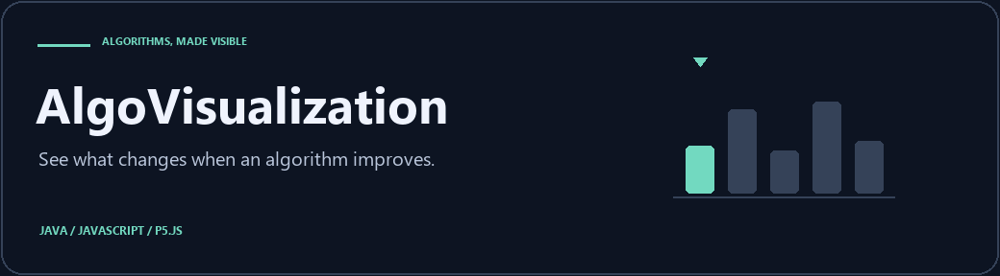

<div align="center">



# AlgoVisualization

**See what changes when an algorithm improves.**


[Overview](#overview) &nbsp; · &nbsp; [Run locally](#run-locally) &nbsp; · &nbsp; [Explore the repository](https://github.com/mcampo0215/AlgoVisualization)

</div>

---

## Overview

A small algorithm-learning project that compares three ways to find duplicate integers. Java examples show the implementations; p5.js sketches make the scan visible one step at a time.

| Compare | Visualize | Experiment |
| :--- | :--- | :--- |
| Follow a nested pair scan, a seen-set approach, and a two-set approach. | Watch values being visited and repeated values being highlighted. | Change the input arrays and sketch frame rates to explore behavior. |

## Run locally

### Java examples

Install a JDK, then run from the repository root:

```sh
cd projFiles
javac bruteDuplicates.java improvedDuplicates.java optimizedDuplicates.java
java bruteDuplicates
java improvedDuplicates
java optimizedDuplicates
```

Each program includes repeated-value, all-equal, and empty-array examples. The two-set version returns a list built from a `HashSet`, so result ordering is not guaranteed.

### Visualizations

Open the [p5.js Web Editor](https://editor.p5js.org/), paste one sketch into `sketch.js`, and press Play. Run the sketches separately.

| Source | What to explore |
| :--- | :--- |
| [sketch1.js](projFiles/sketch1.js) | Nested comparisons with two moving indices. |
| [sketch2.js](projFiles/sketch2.js) | A single traversal using a JavaScript `Set` and result array. |
| [bruteDuplicates.java](projFiles/bruteDuplicates.java) | Pairwise scanning with a list membership check. |
| [improvedDuplicates.java](projFiles/improvedDuplicates.java) | A seen set, with list membership used to deduplicate output. |
| [optimizedDuplicates.java](projFiles/optimizedDuplicates.java) | Separate sets for seen and repeated values. |

## Learning notes

The two-set Java implementation has expected linear scan time with hash sets. The other implementations also perform `List.contains` or `Array.includes` checks, whose cost matters when discussing complexity. The sketches illustrate control flow; they are not a benchmark suite.

---

<p align="center"><a href="#algovisualization">Back to the top</a></p>
